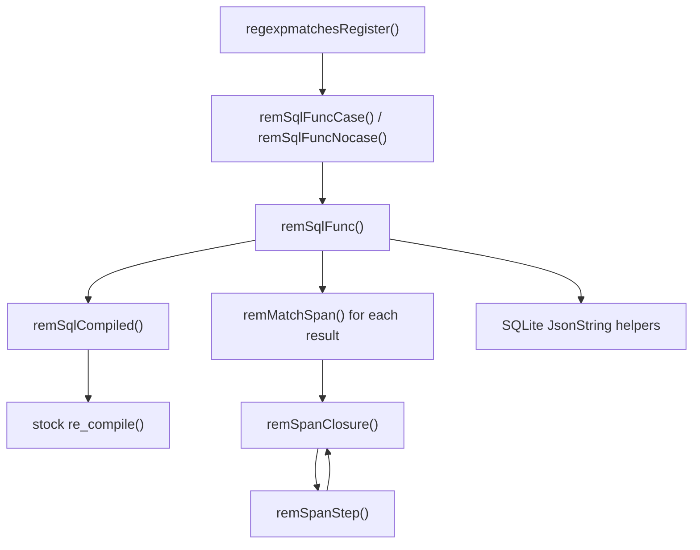

# SQLite `regexpmatches`

[`regexpmatches.c`](src/regexpmatches.c) is an amalgamation-only extension that adds `regexp_matches()` and `regexpi_matches()` to SQLite. Both return successive non-overlapping complete matches as a JSON array. The module uses the compiler and UTF-8 decoder from SQLite's stock [`ext/misc/regexp.c`](https://github.com/sqlite/sqlite/blob/master/ext/misc/regexp.c), together with SQLite's limits, allocators, auxiliary-data cache and JSON builder.

> [!IMPORTANT]
> 
> **AI-Assisted Development Disclosure**
> 
> This project has been developed with extensive generative-AI assistance. Assistance covered project exploration, design discussion, specification development, implementation, testing, technical review, and documentation. See [AI_DISCLOSURE.md](AI_DISCLOSURE.md) for further details. Responsibility for the published software remains with the maintainer.

## SQL interface

```sql
regexp_matches(pattern, input)
regexpi_matches(pattern, input)
```

Both functions return JSON text with SQLite's JSON subtype. `regexpi_matches()` follows stock `regexpi()` and performs ASCII-only case-insensitive matching, preserving the spelling in the input. Patterns and inputs support well-formed UTF-8 text without embedded NULs.

```sql
SELECT regexp_matches('[0-9]+', 'A12 B345');
-- ["12","345"]

SELECT regexpi_matches('ab+', 'ABb ab');
-- ["ABb","ab"]

SELECT regexp_matches('xyz', 'abc');
-- []

SELECT regexp_matches('x', NULL);
-- NULL
```

The pattern is the first argument, matching the direct-call convention of SQLite's existing `regexp(pattern, input)` and `regexpi(pattern, input)` functions.

## Match semantics

Matches are selected using:

- leftmost-first search;
- ordered alternation;
- greedy, non-possessive quantifiers;
- successive non-overlapping global iteration;
- no recursive backtracking or combinatorial path enumeration.

Ordered alternatives are significant:

```sql
SELECT regexp_matches('a|aa', 'aa');
-- ["a","a"]

SELECT regexp_matches('aa|a', 'aa');
-- ["aa"]
```

Greedy repetition still permits the remaining pattern to match:

```sql
SELECT regexp_matches('a+', 'aaa');
-- ["aaa"]

SELECT regexp_matches('.*a', 'a 1 a 2');
-- ["a 1 a"]
```

This behavior is implemented by a prioritized Thompson/Pike VM over the NFA compiled by stock `regexp.c`. Earlier alternatives outrank later alternatives; continuing a greedy quantifier outranks exiting it; and a lower-priority acceptance remains available while a higher-priority path is still viable.

Zero-length matches are returned. After one is selected, iteration advances by one complete UTF-8 code point so matching cannot loop indefinitely. An empty match at the exact end of the preceding non-empty match is suppressed.

Parentheses retain the stock engine's non-capturing behavior. Returned array members are complete matched substrings, not capture groups.

## Integration

Use a SQLite source tree containing the [November 16, 2026 regexp update](https://github.com/sqlite/sqlite/commit/3e5b45b3416a9bc3b54ac10c544e223a13eb6e06). The matcher uses the stock compiler's `RE_OP_ATEND` instruction for `$`. Its other private regexp and JSON dependencies require the following order in one C translation unit.

```text
SQLite amalgamation, including JSON
stock ext/misc/regexp.c
src/regexpmatches.c
```

The stock stage prepares `regexp.c` and generates `misc_ext_init.c`. The [RegexpMatches hook](sqlite_ext_regexpmatches.bat) adds `sqlite3RegexpmatchesInit()` to that dispatcher and appends `regexpmatches.c` to `EXTRA_SRC`. On each new connection, `sqlite3ExtraAutoExtInit()` calls the stock initializer for `regexp()`, `regexpi()` and the `REGEXP` operator, and the project initializer registers the two match-array functions. Applications use them directly when linked to the resulting SQLite library.

## Build on Windows with MSVC

The [SQLite-ICU-MinGW MSVC guide](https://github.com/pchemguy/SQLite-ICU-MinGW/blob/master/Current/MSVC/README.md) is the primary reference for the SQLite build harness. This repository ships one [preset](sqlite_msbuild_bare_icu_ext_extra.bat). It enables Conda ICU, ZLIB, the stock `ext/misc` modules and the RegexpMatches hook. For a custom build, call [sqlite_msbuild.bat](sqlite_msbuild.bat) directly. Keep `SQLITE_EXTRA=1` for stock regexp and the dispatcher, `USE_EXTRAS=1` for the project hook and `SQLITE_ENABLE_REGEXPMATCHES=1` for its registration. The stock stage requires ZLIB. The match functions themselves use the stock regexp engine even in the ICU build.

### Prepare Python and the build tools

Install the MSVC C++ Build Tools and Windows SDK. The checker can activate an installed x64 toolchain. For the preset on x86, use an initialized x86 Native Tools prompt and a matching x86 Conda environment with ICU. Run the commands below from the repository root in a path without spaces for the harness's hook discovery.

If a matching Conda environment with ICU development files and pytest is already active, proceed to the build. For the bundled x64 setup, start a clean `cmd.exe /d /e:on /v:on` with `CONDA_PREFIX` unset, `python.exe` and `conda.bat` off `PATH`, and `curl.exe` and Windows `tar.exe` available. Cache setup replaces the user's pip and uv cache directories with junctions. The bootstrap also removes `%APPDATA%\mamba` if it exists. [Conda Bootstrap](https://github.com/pchemguy/Conda-Bootstrap) · [Cache and filesystem changes](https://github.com/pchemguy/Conda-Bootstrap/blob/main/windows/Anaconda.md#cache-and-filesystem-changes)

```cmd
set "PKGS=python=3.11 icu"
call pyenv\Anaconda.bat
set "PKGS="
call pyenv\conda_far.bat /batch
```

The full bootstrap creates `pyenv\Anaconda` from [Anaconda_bootstrap.yml](pyenv/Anaconda_bootstrap.yml) and installs pytest from [Anaconda.yml](pyenv/Anaconda.yml). `PKGS` requests the specification's Python 3.11 and ICU explicitly. The bootstrap returns early if the prefix already contains `python.exe`. In subsequent clean prompts, run only the activation command. For missing packages in an existing active prefix, use `conda install -c conda-forge icu pytest`. The launcher checks MSVC before activating Conda. The SQLite harness checks the Microsoft linker and verifies that the versioned Conda ICU DLL matches the MSVC target.

### Build the checked-out source

The hook reads `out\cache\SQLiteRegexpMatches\src\regexpmatches.c` and downloads the file from `main` on a cache miss. To build this checkout, seed the cache before invoking the preset. Start with a fresh `out` for a different SQLite snapshot or architecture. For edits to `src\regexpmatches.c`, refresh the cached copy and start with a fresh `out\build` so NMake regenerates the amalgamation.

```cmd
if not exist "out\cache\SQLiteRegexpMatches\src" mkdir "out\cache\SQLiteRegexpMatches\src"
copy /b /y "src\regexpmatches.c" "out\cache\SQLiteRegexpMatches\src\regexpmatches.c"
cmd /d /c sqlite_msbuild_bare_icu_ext_extra.bat
```

On a fresh build, the harness downloads the [SQLite source snapshot](https://sqlite.org/src/zip/sqlite.zip) and the latest ZLIB release, and stages ICU from `%CONDA_PREFIX%\Library`. Later runs reuse `out\cache\sqlite.zip` and the extracted `out\sqlite` tree. If compilation reports an undefined `RE_OP_ATEND`, start with a fresh `out` to obtain the required SQLite source.

| Output | Location |
| --- | --- |
| `sqlite3.exe`, `sqlite3.dll`, ICU runtime DLLs and `zlib1.dll` | `out\bin` |
| SQLite headers | `out\include` |
| DLL import library `sqlite3.lib` and export definition `sqlite3.def` | `out\lib\import` |
| Static SQLite library | `out\lib\static\libsqlite3.lib` |

Check the packaged shell from the repository root.

```cmd
out\bin\sqlite3.exe :memory: "SELECT regexp_matches('^a|b', 'xbb'), regexpi_matches('b$', 'aB');"
```

Expected output is `["b","b"]|["B"]`. To verify the DLL used by Python, follow [Testing](#testing).

## Code walkthrough

### Module workflow



`sqlite3RegexpmatchesInit()` calls the private `regexpmatchesRegister()` helper. A SQL call enters the appropriate case-mode wrapper and then the shared `remSqlFunc()` driver. The driver obtains a cached stock NFA, repeatedly asks `remMatchSpan()` for the next span, appends each source slice through SQLite's JSON builder, and advances the global cursor without allowing overlap.

`remMatchSpan()` runs one prioritized Pike-VM search. At each input boundary, `remSpanClosure()` expands non-consuming transitions in priority order and `remSpanStep()` advances viable consuming threads by one decoded character. The cycle continues until the winning acceptance is known or no match remains.

### Function map

| Function                  | Responsibility                                                                                                                                                                                 |
| ------------------------- | ---------------------------------------------------------------------------------------------------------------------------------------------------------------------------------------------- |
| `regexpmatchesRegister()` | Registers `regexp_matches()` and `regexpi_matches()` with deterministic, innocuous, and result-subtype flags. It is private to the amalgamation.                                               |
| `remSqlFuncCase()`        | Thin case-sensitive SQL callback; delegates to `remSqlFunc()` with stock case folding disabled.                                                                                                |
| `remSqlFuncNocase()`      | Thin ASCII case-insensitive SQL callback; delegates with stock case folding enabled.                                                                                                           |
| `remSqlFunc()`            | Owns the complete SQL operation: NULL propagation, cached compilation, global non-overlapping iteration, zero-length progress, JSON construction, subtype assignment, and SQL error reporting. |
| `remSqlCompiled()`        | Retrieves argument 0 from SQLite auxiliary data or compiles it with stock `re_compile()`. It also records whether the compiler inserted the synthetic unanchored-search prefix.                |
| `remCompiledFree()`       | Auxiliary-data destructor for the extraction wrapper and its stock `ReCompiled` object.                                                                                                        |
| `remMatchSpan()`          | Selects one match at or after a byte cursor. It coordinates the Pike VM, candidate starts, accepting fallbacks, anchors, and final start/end offsets.                                          |
| `remSpanVmInit()`         | Allocates the reusable thread lists, closure stack, and visited-state generations for one span search.                                                                                         |
| `remSpanVmClear()`        | Releases all temporary storage owned by a span search.                                                                                                                                         |
| `remSpanNewGeneration()`  | Advances the visited-state generation used for constant-time thread deduplication; resets markers if the counter wraps.                                                                        |
| `remSpanPush()`           | Pushes one thread onto the ordered epsilon-closure stack with a bounds check.                                                                                                                  |
| `remSpanAddSeed()`        | Adds an entry thread only when a higher-priority thread has not already reached the same opcode.                                                                                               |
| `remSpanClosure()`        | Computes the ordered epsilon closure. It applies fork priority, assertions, jumps, optimized `.*`, and acceptance ordering without consuming input.                                            |
| `remSpanConsumes()`       | Tests one consuming stock regexp opcode against the current character and reports the next opcode. It reuses stock word, digit, and whitespace predicates.                                     |
| `remSpanStep()`           | Runs one consuming VM step for the higher-priority ready threads and constructs the next deduplicated thread list.                                                                             |
| `remSpanPrevChar()`       | Decodes the character immediately before a byte boundary for word-boundary assertions.                                                                                                         |
| `remSpanNextChar()`       | Uses the compiled expression's stock decoder to read the character at a byte boundary and return the next boundary.                                                                            |

### Important control points

`remSqlCompiled()` records whether the first compiled instruction is the synthetic `RE_OP_ANYSTAR` search prefix. This matters for `^a|b`. Only the first alternative is anchored, so the second can match each `b` anywhere in the input. For `^.*a` the compiler replaces the prefix with a jump and the matcher executes the pattern's own `.*`. The pattern-text check in the [original design](docs/explore_develop/SPECIFICATION.md#95-unanchored-search-state) describes the earlier compiler.

`remSpanClosure()` is where regex-path priority becomes concrete. For a positive `RE_OP_FORK`, fall-through is visited first, preserving ordered alternation and greedy optional operands. For a negative fork displacement, the repeated path is visited before the exit path. The first thread reaching an opcode in one generation wins; later duplicates cannot have different
future behavior and are discarded.

`remMatchSpan()` does not immediately return on `RE_OP_ACCEPT`. It retains the acceptance as a fallback while any higher-priority thread remains viable. This is what makes the first branch win in `a|aa` while still allowing greedy non-possessive matching in `.*a`.

Finally, `remSqlFunc()` turns single-span selection into global matching. A non-empty result moves the cursor to its end. An empty result advances by one UTF-8 code point, except at end-of-input, and an empty match directly abutting the preceding non-empty result is not emitted.

## Supported pattern language

The included stock `regexp.c` defines the pattern language.

- Repetition with `*`, `+`, `?`, `{m}`, `{m,n}` and `{m,}`
- Grouping and alternation
- `^` and `$` anchors
- `.`, bracket character classes and negated classes
- `\b`, `\w`, `\W`, `\d`, `\D`, `\s` and `\S`
- Character escapes supported by the stock compiler

It does not add capture extraction, replacement, splitting, overlap mode, flags argument, lazy or possessive quantifiers, lookaround, backreferences, named groups, Unicode case folding, or PCRE syntax.

## Complexity

The span executor is a prioritized Pike VM. At each input boundary, the first thread reaching a compiled program counter wins and duplicate threads are discarded. One span search is bounded by `O(P × I)` time and `O(P)` active-state memory, where `P` is the compiled NFA size and `I` is the examined input length.

Global extraction restarts after each selected match. A higher-priority path may inspect text beyond the fallback match ultimately returned. With `K` results and a possible final unsuccessful search, worst-case search time is `O((K + 1) × P × I)`. The JSON output also requires space proportional to its serialized length.

## Testing

The suite exercises the public SQL functions through Python's standard `sqlite3` module. To select the DLL from `out\bin` for a test run, preload it in a fresh Python process before importing pytest. Run this command from the repository root in the activated Conda environment.

```cmd
python -c "import ctypes, os; dll = ctypes.CDLL(os.path.abspath(r'out\bin\sqlite3.dll')); import pytest; raise SystemExit(pytest.main())" -v regexpmatches/tests
```

Append `-m complexity` to that command to select only the adversarial cases. When Python already links to the custom SQLite, run pytest directly.

```cmd
python -m pytest -v regexpmatches/tests
python -m pytest -v -m complexity regexpmatches/tests
```

The session check reports the SQLite version and source ID if required registrations are missing. An optional `--sqlite-source-id "..."` or `REGEXP_TEST_SOURCE_ID` requests a warning on a snapshot mismatch. The checks use fresh in-memory connections to cover stock regexp, match selection and priority, zero-length progress, UTF-8 slicing, JSON subtype propagation through expression indexes, compiler errors and connection limits.

## Repository layout

| Path | Purpose |
| --- | --- |
| [src/regexpmatches.c](src/regexpmatches.c) | Amalgamation module and registration entry point |
| [sqlite_msbuild.bat](sqlite_msbuild.bat), [sqlite_msbuild_bare_icu_ext_extra.bat](sqlite_msbuild_bare_icu_ext_extra.bat) | Windows build harness and project preset |
| [sqlite_ext_regexpmatches.bat](sqlite_ext_regexpmatches.bat), [tool/](tool/) | Project source hook and amalgamation helpers |
| [pyenv/](pyenv/) | Windows Conda bootstrap, activation scripts and package manifests |
| [regexpmatches/tests/](regexpmatches/tests/) | Public-SQL pytest suite |
| [SPECIFICATION.md](docs/explore_develop/SPECIFICATION.md) | Original design specification and SQL acceptance criteria |
